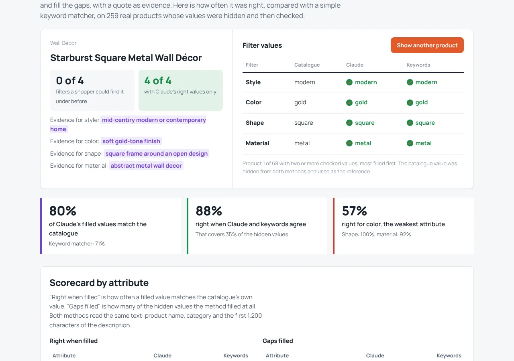

# Catalog Attribute Extractor

**Can AI fill the shop filters a catalogue is missing? An n8n workflow asks Claude to read product text and fill style, color, shape and material, with a quote as evidence. Scored against a keyword matcher on 259 real products whose values were hidden.**

**Current version:** 0.1.0

Live results: https://kostasxeras.com/catalog-attribute-extractor/



## Why this exists

Shop filters only work if products have values for them. In the WANDS furniture catalogue (42,994 products), 42% of products have a usable style value, 28% a color, 23% a material and 18% a shape. A product without a value never appears when a shopper filters by it.

Filling these by hand does not scale, and filling them with AI raises the product question: which values can go live without a person checking them?

## What it does

- **n8n workflow** (`workflows/01-extract.json`): takes products, sends them to Claude ten at a time, and asks for one value per attribute from a fixed list, plus a quote from the text that supports it.
- **Check step**: a value is only proposed if it is on the allowed list and its quote is actually in the product text. Every answer is saved to an n8n data table with a status. Nothing is written to the catalogue.
- **Scoring**: 300 products were sampled from those that already have values. The values were hidden from Claude, then used to score the answers. A keyword matcher with no AI ran on the same text as a baseline.
- **Results page** (`index.html`): the scorecard, a "which values can go live" simulator, and every scored answer with its evidence.

## Main findings

Full detail in the [case study](docs/case-study.md). Scored on 259 products and 379 hidden values.

| | Claude | Keyword matcher |
|---|---|---|
| Right when it fills a value | 80% (133 of 167) | 71% (127 of 180) |
| Hidden values it filled | 44% | 47% |

- **When Claude and the keyword matcher agree, they are right 88% of the time** (115 of 131). Auto-filling only those values fills 35% of the gaps with 16 wrong values. Auto-filling every Claude answer fills 44% with 34 wrong values.
- **When they disagree, Claude is right 39% of the time** (9 of 23). Those values need a person.
- **Shape and material are reliable** (100% and 92% right). **Color is not** (57%).
- **Some "errors" are probably label problems.** In 16 of Claude's 21 wrong style values, the quote names Claude's style directly, for example "a traditional chandelier design" for a product labelled farmhouse. This is a hypothesis: the dataset cannot tell whether the label or the text is wrong.
- **The evidence check never fired.** All 376 values Claude proposed came with a quote that was really in the text. One value outside the allowed list was rejected.

## How it was run

- n8n Cloud, Claude Haiku through n8n's built-in AI credits, temperature 0, 20 November 2026.
- 20 separate products were used to check the prompt and workflow. They are not part of the 300.
- 41 of the 300 products are not scored, because their batch came back from Claude empty or cut off. Both methods are scored on the same 259 products. See the case study for what happened.

## Data

[WANDS](https://github.com/wayfair/WANDS) product data by Wayfair, MIT licence. The catalogue's own values are cleaned into short value lists (for example "rectangle" and "rectangular" both become rectangular). The same lists are given to Claude.

## My role

I framed the problem, chose the attributes, the baseline and the review rule, and wrote the findings. Decisions are recorded in [docs/decisions](docs/decisions).

## Run it yourself

- **Results page:** open `index.html` through any local web server, for example `python3 -m http.server`.
- **Workflow:** in n8n, Workflows > Import from file > `workflows/01-extract.json`. Create a data table named `cae_proposals` with the columns run_id, product_id (number), product_name, attribute, value, evidence and status. Connect an Anthropic credential to the Claude node, or use n8n's AI credits.
- **Scoring:** `npm run check`, `npm run baseline`, `npm run score` (Node and Python 3). To rebuild the samples, download WANDS `product.csv` into `scripts/` and run `npm run samples`.

## Repo layout

```
index.html                 Results page
workflows/01-extract.json  The n8n workflow
data/input/                Products sent to Claude (no labels)
data/labels/               The hidden catalogue values
data/results/raw/          Claude's answers exactly as returned
data/results/              Checked answers, baseline answers, scorecard
scripts/                   Sampling, keyword baseline, check, scoring
docs/case-study.md         Question, approach, findings, next steps
docs/product-brief.md      Users, goals, scope
docs/decisions/            One record per real trade-off
```
